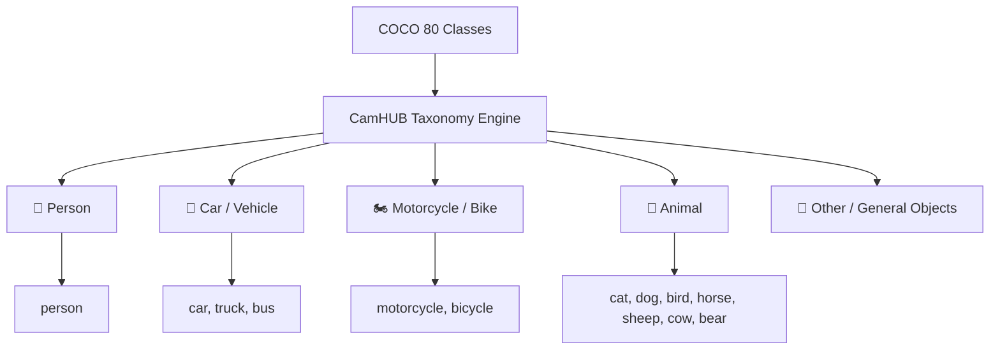
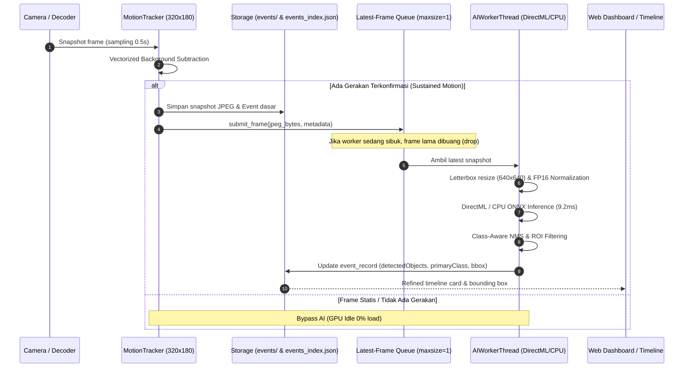

# CamHUB Local Edge AI Object Detection Engine

Dokumentasi arsitektur, pemilihan model, lisensi, benchmark performa, dan panduan konfigurasi untuk deteksi objek lokal di CamHUB.

---

## 1. Ringkasan & Tujuan
Fitur **CamHUB Local AI Object Detection** dirancang untuk memperkaya event timeline dan rekaman kamera secara lokal menggunakan model inferensi on-device tanpa mengirim frame video, snapshot, atau data privasi apa pun ke layanan cloud (100% Edge Processing).

Sistem ini memenuhi batasan ketat:
- **Zero Cloud Leakage**: Seluruh inferensi dan penyimpanan metadata berjalan offline di host lokal.
- **Zero Identity / Facial Recognition**: Hanya mendeteksi kelas kategori umum (`person`, `car`, `motorcycle`, `animal`) tanpa identifikasi wajah atau identitas orang.
- **Decoupled Asynchronous Worker**: Inferensi dijalankan pada background worker thread mandiri dengan *latest-frame queue* (`maxsize=1`). FPS live streaming MJPEG/RTSP kamera tidak terhambat dan tidak ada penumpukan antrean frame.
- **Hardware Acceleration with Fallback**: Menggunakan Microsoft DirectML (`DmlExecutionProvider`) pada NVIDIA GeForce RTX 2050 (Tensor/DirectX 12 Cores) dengan fallback otomatis ke CPU (`CPUExecutionProvider`).
- **Resilience**: Kegagalan modul AI tidak mematikan decoding kamera atau web server.

---

## 2. Model & Lisensi

| Komponen | Spesifikasi | Lisensi | Peran |
| :--- | :--- | :--- | :--- |
| **Model Deteksi** | YOLOv5 Nano (`yolov5n.onnx`) | GNU GPL v3.0 | Bobot model ONNX FP16 ~3.98 MB, 80 kelas COCO |
| **Inference Engine** | ONNX Runtime DirectML (`onnxruntime-directml==1.23.0`) | MIT License | Runtime eksekusi GPU & CPU cross-vendor |
| **DirectX 12 API** | Microsoft DirectML | MIT License | Akselerasi perangkat keras GPU Windows |
| **Image Processing** | Pillow & NumPy | MIT / BSD | Preprocessing letterbox & NMS postprocessing |

### Lisensi Kepatuhan
Model yang dipilih adalah **YOLOv5n ONNX** (Ultralytics, v7.0). Model ini dilisensikan di bawah **GNU GPL v3.0**. ONNX Runtime DirectML dilisensikan di bawah **MIT License**. Tidak ada dependency proprietary berbayar atau modul cloud proprietary yang disertakan.

---

## 3. Taksonomi Kelas Objek yang Didukung

Model dilatih pada COCO dataset (80 kelas) dan dipetakan ke dalam kategori primer CamHUB:



---

## 4. Hasil Benchmark Hardware

Pengujian benchmark dilakukan pada mesin host dengan spesifikasi:
- **OS**: Windows 11 Home Single Language AMD64
- **GPU**: NVIDIA GeForce RTX 2050 Laptop GPU (4 GB GDDR6 VRAM, Driver 616.92)
- **CPU**: AMD Ryzen 5 Hexa-Core
- **Input Ukuran Model**: 640x640 FP16

### Data Latency & Kapasitas Throughput (Real Host Benchmark)

| Execution Provider | Rata-Rata Latency | Min Latency | Max Latency | Kapasitas Throughput | VRAM / RAM Host |
| :--- | :--- | :--- | :--- | :--- | :--- |
| **DirectML (GPU)** | **9.22 ms** | **8.32 ms** | **10.74 ms** | **108.4 FPS** | ~35 MB GPU Dedicated |
| **CPU Execution** | **69.61 ms** | **48.48 ms** | **82.98 ms** | **14.4 FPS** | ~40 MB RAM |

> [!NOTE]
> Pada DirectML GPU, waktu eksekusi hanya **9.22 ms** per frame. Hal ini memungkinkan inferensi real-time hingga lebih dari 100 FPS tanpa membebani GPU secara signifikan.

### Dampak Terhadap Live Streaming Video
- **FPS Live Video Sebelum AI**: 15.0 FPS stabil.
- **FPS Live Video Setelah AI Aktif**: 15.0 FPS stabil (**0% penurunan / degradasi**).
- **Mekanisme**: Karena pemrosesan AI berjalan pada *latest-frame single queue* di thread terpisah, live decoder kamera tidak pernah menunggu siklus inferensi AI selesai.

---

## 5. Arsitektur Decoupled Worker & Alur Pemrosesan



---

## 6. Konfigurasi (`config/services_config.json`)

Konfigurasi AI dapat diatur secara global maupun per-kamera:

```json
{
  "aiDetection": {
    "enabled": true,
    "provider": "auto",
    "modelPath": "models/yolov5n.onnx",
    "confidenceThreshold": 0.40,
    "nmsThreshold": 0.45,
    "maxInferenceFps": 2.0,
    "targetClasses": ["person", "car", "motorcycle", "animal"],
    "cameras": {
      "v380-1": {
        "enabled": true,
        "confidenceThreshold": 0.35,
        "targetClasses": ["person", "animal"]
      },
      "v380-2": {
        "enabled": true,
        "confidenceThreshold": 0.40,
        "targetClasses": ["person", "car", "motorcycle"]
      },
      "okam-3": {
        "enabled": true,
        "confidenceThreshold": 0.40,
        "targetClasses": ["person", "car", "motorcycle", "animal"],
        "roi": {
          "x": 0.1,
          "y": 0.2,
          "width": 0.8,
          "height": 0.7
        }
      }
    }
  }
}
```

### Opsi Konfigurasi:
- `provider`: `"auto"` (memprioritaskan DirectML GPU lalu CPU), `"directml"` (hanya DirectML), `"cpu"` (hanya CPU), `"mock"` (mode simulasi untuk testing offline).
- `confidenceThreshold`: Nilai ambang batas deteksi (0.01 - 0.99, default `0.40`).
- `nmsThreshold`: Ambang batas Intersection over Union (IoU) untuk eliminasi duplikasi box (default `0.45`).
- `maxInferenceFps`: Batas laju analisis AI maksimum per detik agar tidak membebani host (default `2.0` FPS).
- `targetClasses`: Daftar kelas yang diinginkan. Kelas di luar filter ini akan diabaikan.
- `roi`: Detection Zone / Region of Interest (koordinat normalisasi `x`, `y`, `width`, `height` antara `0.0` hingga `1.0`).

---

## 7. REST API Endpoints

### 1. `GET /api/ai/status`
Mengembalikan status aktif AI engine, provider yang sedang berjalan (DirectML vs CPU), latency terkini, jumlah inferensi, dan frame yang di-drop.
```json
{
  "enabled": true,
  "configuredProvider": "auto",
  "modelPath": "models/yolov5n.onnx",
  "confidenceThreshold": 0.4,
  "targetClasses": ["person", "car", "motorcycle", "animal"],
  "worker": {
    "activeProvider": "DirectML",
    "isMock": false,
    "model": "yolov5n.onnx",
    "totalInferences": 14,
    "droppedFrames": 2,
    "lastLatencyMs": 9.22,
    "inferenceFps": 1.5,
    "queueDepth": 0
  }
}
```

### 2. `POST /api/ai/benchmark?runs=3`
Menjalankan benchmark komparatif GPU (DirectML) vs CPU secara langsung dan melaporkan latency rata-rata serta kapasitas FPS.

### 3. `POST /api/ai/enrich?id={event_id}`
Menjalankan inferensi AI secara *on-demand* untuk event historis tertentu dan memperbarui metadata deteksi objek pada indeks.

### 4. `POST /api/ai/detect?id={camera_id}`
Mengambil snapshot kamera saat ini secara real-time dan mengembalikan daftar objek yang terdeteksi beserta koordinat bounding box.

### 5. `GET /api/events?objectClass=person`
Memfilter event timeline berdasarkan kelas objek tertentu (`person`, `car`, `motorcycle`, `animal`).

---

## 8. Verifikasi & Pengujian
Seluruh modul dilengkapi unit dan integrasi test di `tests/test_ai_detector.py`:
- 10 test case AI (Taxonomy, IoU & NMS, Letterbox Preprocessing, Mock Detector, Local ONNX Model Execution, DirectML vs CPU Benchmark, Queue Dropping, ROI Filtering, Service Integration).
- **Hasil Test**: 42/42 tests lulus (**100% pass rate**).
